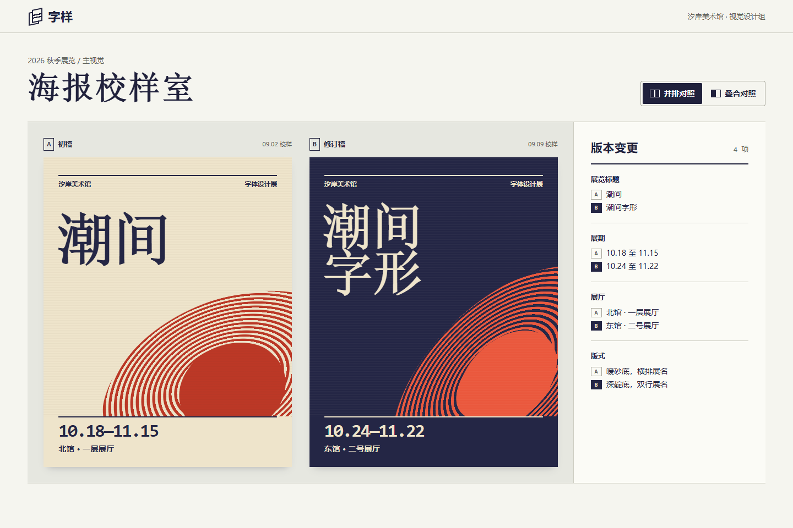

# FORMA · 前端设计工作室

一套面向中文前端项目的 UI/UX skill，配有可以直接操作和标注的 HTML 样页。设计品牌官网时，它帮你选择主视觉和阅读节奏；做业务平台或大屏时，它帮你把版面留给用户要比较的数据、要处理的异常和下一步操作。



## 三分钟开始评审

下载并解压仓库，或用 SSH 克隆到本机。

```sh
git clone git@github.com:fruge365/forma-frontend-design-studio.git
cd forma-frontend-design-studio
```

在含有 `package.json` 的根目录执行以下命令（Node.js 20 或更高版本，无需安装第三方依赖）：

```sh
npm start
```

启动后，可在本机浏览器体验二十二个样页。先用「浏览」操作，再切到「＋ 标注」点击具体元素。桌面侧栏可以按名称或业务检索样页，手机选择器按任务分组。第十轮可从海报的局部改动和权限的逐项变更开始评审。[本机评审台](http://127.0.0.1:4173/) · [海报校样室](http://127.0.0.1:4173/?page=proofroom) · [权限变更审阅](http://127.0.0.1:4173/?page=policy-diff)

| 你想做什么 | 命令 |
| --- | --- |
| 检查仓库及本地服务 | `npm test` |
| 4173 被占用时改用 4180 | `npm start -- 4180` |
| 直接通过 Node 启动 | `node serve-review.cjs 4173` |

服务仅监听本机，按 Ctrl+C 停止。线上静态托管不需要运行这个 Node 服务。

维护空间类样页时，可另跑一次[浏览器回归](scripts/spatial-browser.cjs)，在全新浏览器内检查地点标注的导出、导入和重新定位，以及定位货位时盘点数据是否保持原值。在开发目录执行 `npm install --no-save --package-lock=false playwright`、`npx playwright install chromium`，再执行 `npm run test:spatial`。日常评审和 `npm test` 无需这一步。

维护纸面预览时，可在上面的浏览器测试环境运行 `npm run test:paper`，复查节目范围、交班草稿版本，以及标注图钉是否从打印版移除。[纸面标注回归脚本](scripts/paper-browser.cjs)

维护版本对照时，用 `npm run test:comparison` 检查在擦拭画布上标注和恢复分界、保留旧版本意见及权限审阅的确认步骤。[版本对照回归脚本](scripts/comparison-browser.cjs)

## 在自己的项目使用 skill

将整个 [frontend-design-studio](frontend-design-studio/) 目录复制到目标项目的 `.agents/skills/` 下，保留 `SKILL.md`、`references/` 和 `assets/` 等原始结构。也可以让支持读取本地文件的助手直接读取 [SKILL.md](frontend-design-studio/SKILL.md)。只需要设计规范时，无须启动评审台。

例如，在目标项目中发出这条请求：

> 使用 $frontend-design-studio 重做园区设备巡检首页。值班员主要在 1366px 笔记本上使用，先找离线设备，再分派工单。保留现有品牌和组件。请实现筛选、派单和失败反馈，并用真实长度的中文名称检查布局。

## 二十二个可操作的样页

| 场景 | 样页源码 | 适合评审的问题 |
| --- | --- | --- |
| 品牌官网 | [LUMA 空间音箱](html-review/website.html) | 第一屏能否讲清产品？主视觉和标题在窄屏怎样排列？ |
| 业务系统 | [澄序团队工作台](html-review/platform.html) | 一个项目很多时，能否找到任务并完成下一步操作？ |
| 能源大屏 | [江湾能源运行中心](html-review/bigscreen.html) | 远看能否发现异常，近看能否核对单位、范围和时间？ |
| 文化活动 | [阅川 · 沿江阅读季](html-review/culture.html) | 插画吸引读者后，能否顺利找到场次、加入计划？ |
| 手机办理 | [阅川 · 自习座位预约](html-review/library.html) | 同一品牌换到手机，能否选定时段、座位并确认预约？ |
| 调度分析 | [潮汐调度](html-review/mobility.html) | 能否区分缺报和零值、实测和预测，并找到要补车的站点？ |
| MES 生产排程 | [叠尺 · 生产排程](html-review/scheduling.html) | 产线和时间交叉时能否看出空档？换线产生冲突时能否找到原工单？ |
| 技师 App | [栖庭 · 现场巡检](html-review/field-app.html) | 技师返回工单后，能否找到刚处理的任务和本机草稿？ |
| 微信小程序 | [栖庭 · 访客报修](html-review/repair-mini.html) | 访客从带有地点的入口进入，能否核对、提交并找到回执？ |
| 布局与配色 | [财务、CRM、WMS 对照](html-review/style-lab.html) | 换肤后差额与操作还醒目吗，切换工作后阅读顺序是否合适？ |
| 公共服务申请与审批 | [栖原 · 场地借用](html-review/intake.html) | 从核对页修改一组信息、退回补正、再次提交后，能否找回原申请与退回原因？ |
| 商品配置与履约 | [汀印 · 版画装裱室](html-review/editions.html) | 改变尺寸、纸色或画框后预览与价格是否一致？配送改成店取后，清单还保留哪些信息？ |
| 材料检索与对比 | [物样 · 材料样本馆](html-review/materials.html) | 如何用纹理初选材料、在手机上取消筛选，再按同一单位比较规格？ |
| 运营批量复核 | [北线 · 设备巡检台账](html-review/assets.html) | 能否看清当前页、已选与可处理的设备，确认后能否核对实际变更？ |
| 移动长文阅读 | [折页 · 活字印刷札记](html-review/reader.html) | 读到一半调大字号和行距，能否在原段接着阅读？暗色中的正文和图注是否清楚？ |
| 舞台提示与值守 | [候场 · 舞台提示台](html-review/cues.html) | 只预览其他提示时，能否认出当前和待执行对象？执行和撤销后能否从日志确认结果？ |
| 河岸建筑导览 | [沿岸 · 河岸建筑漫步](html-review/atlas.html) | 从图上看见的建筑，能否仅凭名称和编号在目录找到？切换视图后还是同一站吗？ |
| 库区平面与盘点 | [仓位 · 库区作业板](html-review/depot.html) | 货架位置、库存状态和当前选中的货位是否分得清？盘点是否落在所核对的地址？ |
| 音乐节官网与节目单 | [声场 · 室内乐周](html-review/programme.html) | 跨两天挑选的场次如何排在一张节目单上？打印预览里的日期、时间和场地是否齐全？ |
| 设备交班与纸面归档 | [接力 · 设备交班](html-review/handover.html) | 草稿与已生成单据是否容易区分？在下一班继续工作后重印旧单，交接记录仍属于哪一班？ |
| 展览海报校样 | [字样 · 海报校样室](html-review/proofroom.html) | 两稿尺度是否一致？切换并排、擦拭和端点后还能定位到原处吗？ |
| 权限变更审阅 | [门册 · 角色权限](html-review/policy-diff.html) | 权限排序改变后，新授予、撤销和适用范围变化能否与生效版本逐项核对？ |

[查看权限审阅桌面截图](docs/images/policy-diff.png) · [查看设备交班桌面截图](docs/images/handover.png) · [查看库区作业板桌面截图](docs/images/depot.png)

从两个样页导出的 A4 样张可直接下载。跨日节目单只含个人挑选的两场演出。交接单的两页可以分开核对，页首都有班次和单号。[跨日节目单 PDF](docs/samples/personal-programme.pdf) · [设备交接单 PDF](docs/samples/shift-record.pdf)

技师 App 和报修小程序为独立 HTML 交互原型，可在浏览器中评审。开发移动项目时，另有 App、微信小程序与 H5 的路由、安全区、权限、触控单位和真机检查说明。对账、客户档案、仓库执行、产线排程、内容审校、审批与服务门户的版式取舍也可单独查阅。[移动平台指南](frontend-design-studio/references/mobile-platforms.md) · [业务系统布局与配色](frontend-design-studio/references/system-layouts.md)

评审台支持切换画布宽度、给具体元素或整页留意见、评分、标记已处理，以及导入／导出 JSON。Markdown 评审单适合阅读。意见和样页操作记录存在当前浏览器中，分享页面链接不会同步这些记录；向他人交接时请导出反馈。详见 [使用与评审说明](使用说明.md)。

## 上传仓库与发布演示

项目仓库位于 [fruge365/forma-frontend-design-studio](https://github.com/fruge365/forma-frontend-design-studio)。

**发布自己的副本。** 在自己的账号下建一个空仓库，把本项目的完整目录作为仓库根目录，包括 `.github/` 等点开头的文件。使用 Git 的话，在项目根目录依次执行（若解压自 ZIP，先运行 `git init -b main`）：

```sh
git add .
git commit -m "Add FORMA design skill and interactive review studio"
```

然后执行 `git remote add origin 你的仓库地址`（把最后一项换成平台给出的 HTTPS 或 SSH 地址）和 `git push -u origin main`。也可以使用平台的上传文件功能；上传解压后的内容，不是 ZIP 本身。参见 [GitHub 官方上传说明](https://docs.github.com/en/repositories/working-with-files/managing-files/adding-a-file-to-a-repository)。

**用 GitHub Pages 展示评审台。** 仓库上传后，打开 **Settings → Pages → Source → GitHub Actions**，再到 **Actions → Deploy review to GitHub Pages → Run workflow**，选择默认分支。工作流只部署 [html-review/](html-review/)；成功后的访问地址显示在工作流的 `github-pages` 环境。常规推送和拉取请求会运行检查，不会自动发布演示。配置说明见 [GitHub Pages 官方文档](https://docs.github.com/en/pages/getting-started-with-github-pages/using-custom-workflows-with-github-pages)。

**用其他静态主机。** 将 `html-review/` 作为发布目录，入口为 `index.html`，无需构建。二十三个 HTML 放在同一目录、同一来源，可以使用域名根目录或 `/项目名/` 子目录。

## 如何继续训练

这里的“训练”是修改可复用的设计指令，并用实际页面验证。它不修改模型权重。

1. 在评审台指出具体元素，说明看到了什么、希望怎样改，选择「仅当前页面」「同类任务」或「个人偏好」。
2. 导出 JSON，把它和需求一起交给下一次迭代；真实项目的反馈文件默认不进仓库。
3. 修正对应样页，再用不同数据或场景验证。只把能迁移的判断写回 [场景参考](frontend-design-studio/references/)。

样页中的品牌、业务和数据均为虚构演示。[版本对照与差异审阅](frontend-design-studio/references/version-comparison.md) · [第十轮训练记录](docs/training-round-10.md) · [从屏幕到纸面](frontend-design-studio/references/screen-and-print.md) · [第九轮训练记录](docs/training-round-9.md) · [空间图与等价目录](frontend-design-studio/references/spatial-interfaces.md) · [第八轮训练记录](docs/training-round-8.md) · [外观偏好、阅读位置与动态反馈](frontend-design-studio/references/appearance-and-reading.md) · [第七轮训练记录](docs/training-round-7.md) · [第六轮训练记录](docs/training-round-6.md) · [第五轮训练记录](docs/training-round-5.md) · [第四轮训练记录](docs/training-round-4.md) · [第三轮训练记录](docs/training-round-3.md) · [小米、华为、Rokid、Apple 等官方案例的研究与取舍](frontend-design-studio/references/brand-research.md)
