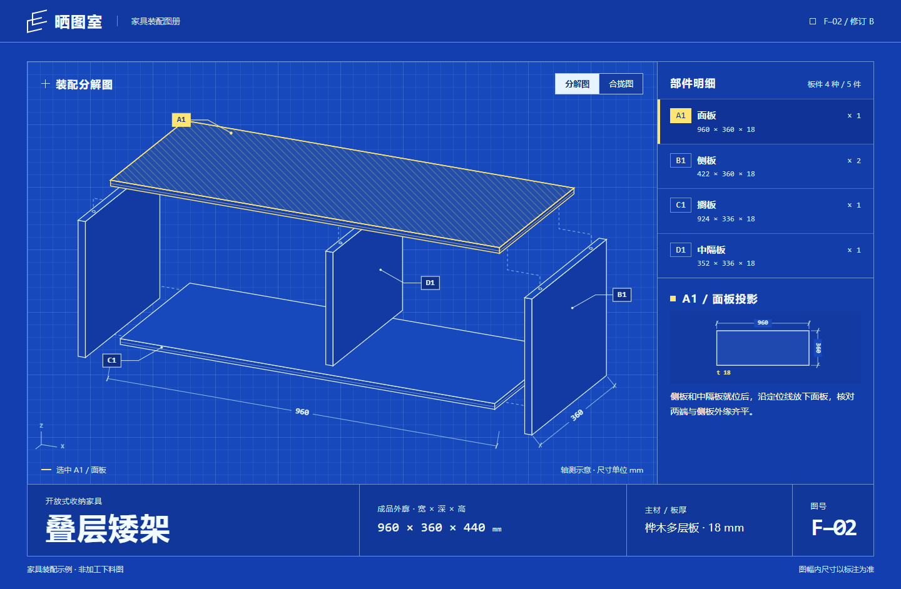
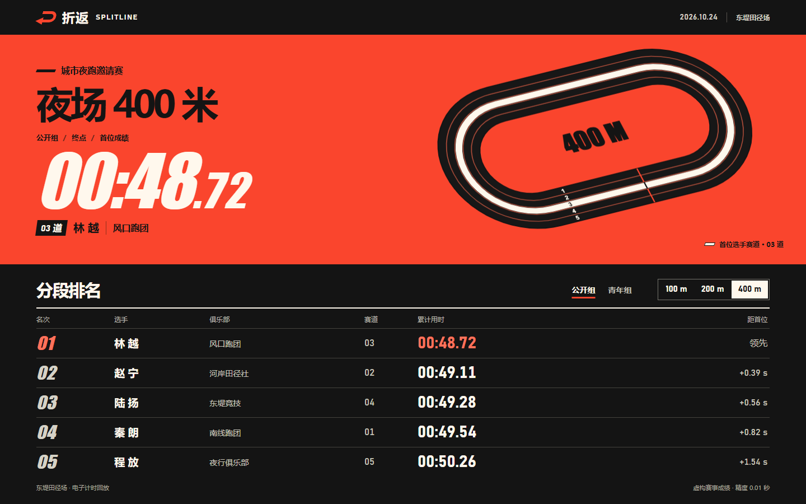
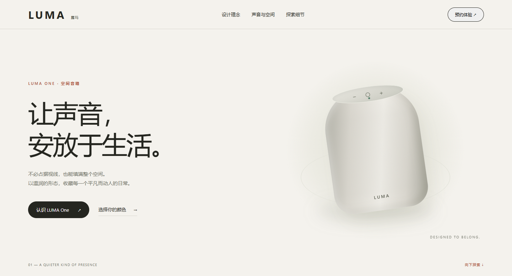
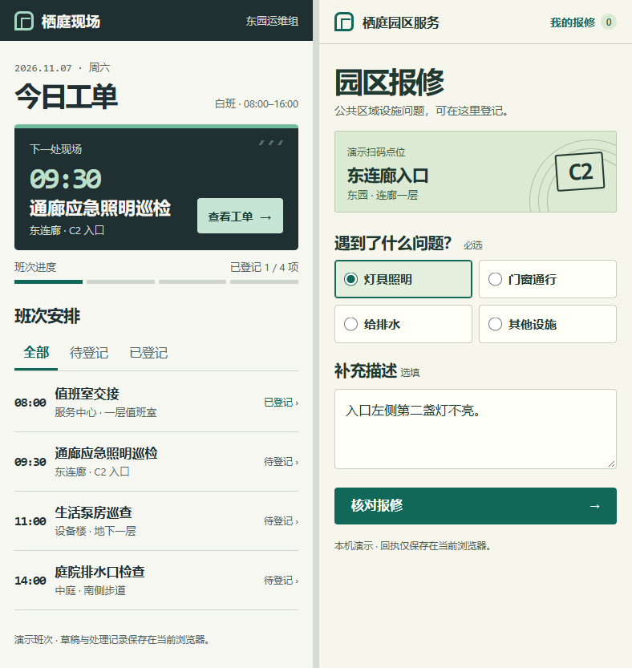
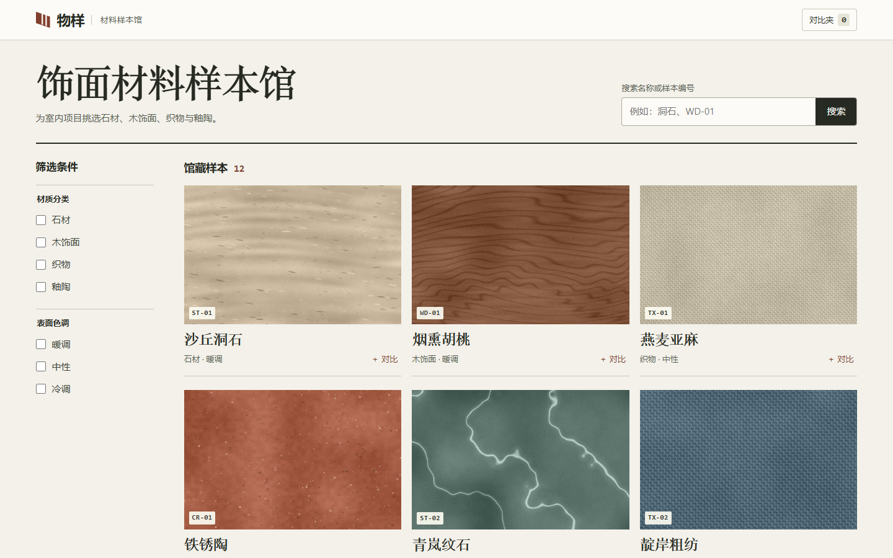
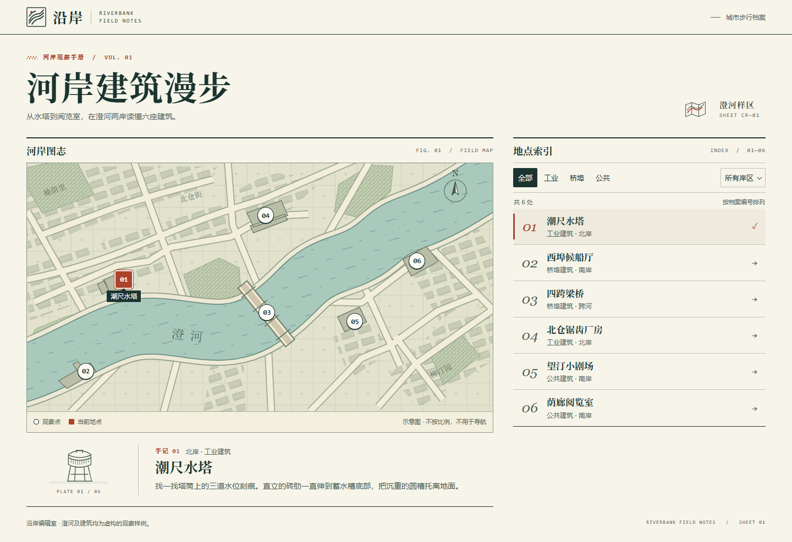
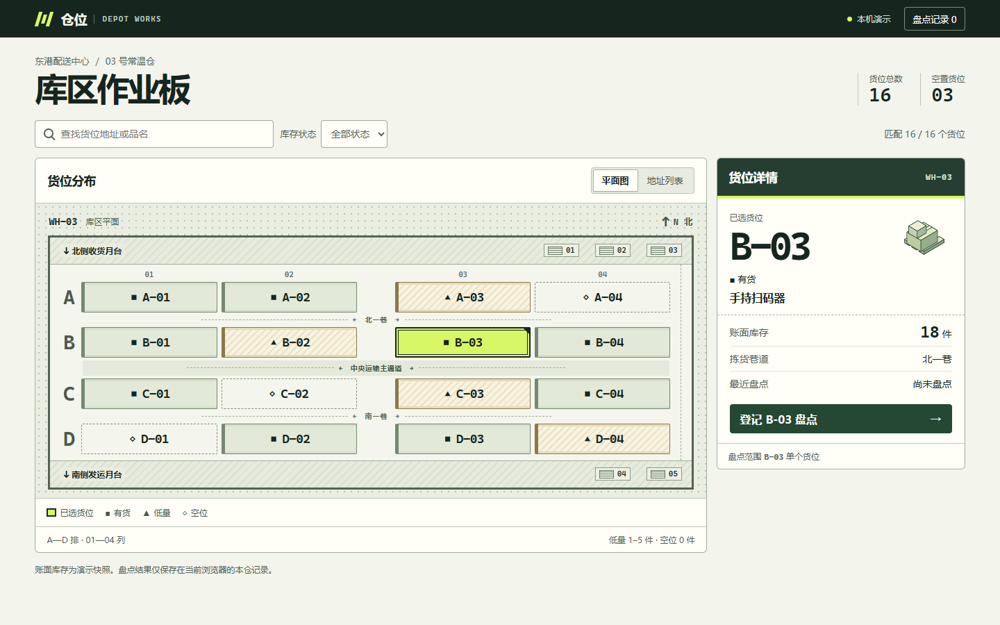
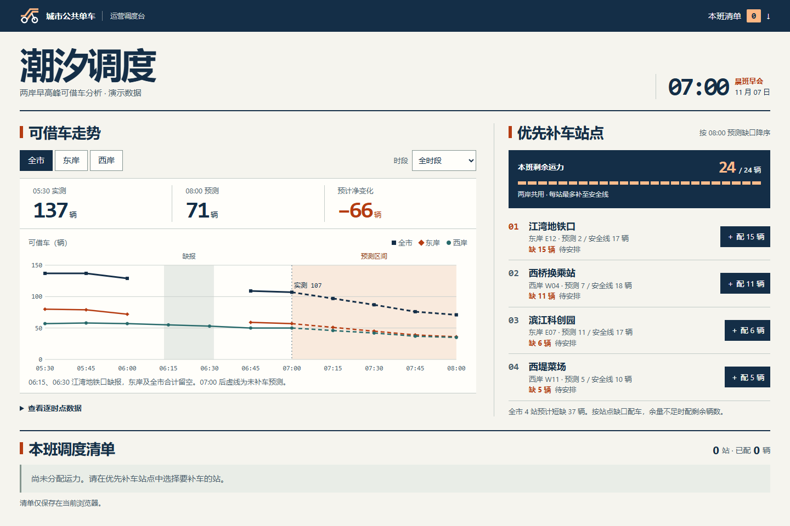

# FORMA UI/UX Design

给 AI 编程助手使用的中文前端设计技能。告诉它谁会用这个页面、在哪种屏幕上用、最常做什么，它会据此选择布局、字阶、配色和交互，并在你的项目中实现。适用于指挥大屏、公共信息屏、品牌官网、业务系统、App 和微信小程序。

[选择开发工具](#按平台安装和使用) · [选一个视觉方向](#风格速览) · [大屏、官网与移动示例](#更多界面风格) · [下载技能包](https://github.com/fruge365/forma-frontend-design-studio/releases/download/v11.0.0/forma-ui-ux-design-v11.0.0.zip)

## 风格速览

点击截图可打开页面。想在自己的项目中使用某种方向，可以把图下的设计描述与业务需求一起发给技能。

| **花艺画册 · 花序** | **工程蓝晒 · 晒图室** |
| --- | --- |
| [](https://fruge365.github.io/forma-frontend-design-studio/bloom.html) | [](https://fruge365.github.io/forma-frontend-design-studio/blueprint.html) |
| 用莓果红作底，让花材摄影占据半幅页面。品种、价格与花束尺寸排在另一侧，像一本可以订购的花册。 | 让整张屏幕成为蓝图，部件的爆炸视图占据中心。白线交代结构，亮黄标出正在装配的零件。 |

| **赛道计时 · 折返** | **像素掌机 · 芽间** |
| --- | --- |
| [](https://fruge365.github.io/forma-frontend-design-studio/splitline.html) | [](https://fruge365.github.io/forma-frontend-design-studio/sprout.html) |
| 用斜体大数字做第一眼的焦点，跑道和近黑成绩带分层。切换计时点，领跑选手、赛道和成绩同步改变。 | 用薄荷绿、淡紫机身与杏橙按键做一台掌上计时器。像素花床记录完成的专注段数，手机上也能单手操作。 |

## 按平台安装和使用

在目标项目的根目录打开终端，展开你的开发工具，运行对应的**安装命令**。然后在该工具里打开同一个项目，把**调用示例**发到对话中。下面的 `gh` 命令使用 GitHub CLI 的 `skill install` 功能，默认安装到当前项目。[GitHub CLI 安装说明](https://cli.github.com/manual/gh_skill_install)

<details open>
<summary><strong>Codex</strong> · 用 <code>$</code> 点名技能</summary>

```sh
gh skill install fruge365/forma-frontend-design-studio forma-ui-ux-design@v11.0.0 --agent codex
```

在 Codex 对话中输入 `$`，选择 `forma-ui-ux-design`，也可以直接发送下面这条需求。

```text
$forma-ui-ux-design 为港口做一张 1920×1080 的离港大屏。乘客站在三米外，需要先看到下一班船、目的地和闸口。用黄黑导视风格，并为手机提供按时间排列的班表。
```

项目安装位置为 `.agents/skills/forma-ui-ux-design/`。[Codex 技能文档](https://developers.openai.com/codex/skills/)

</details>

<details>
<summary><strong>Claude Code</strong> · 用 <code>/forma-ui-ux-design</code> 调用</summary>

```sh
gh skill install fruge365/forma-frontend-design-studio forma-ui-ux-design@v11.0.0 --agent claude-code
```

在 Claude Code 对话中输入技能名和需求。

```text
/forma-ui-ux-design 为桌面音箱做一个品牌官网。用暖白背景和大幅产品特写，第一屏能查看两种外壳材质，手机上保留切换入口。
```

项目安装位置为 `.claude/skills/forma-ui-ux-design/`。[Claude Code 技能文档](https://code.claude.com/docs/en/skills)

</details>

<details>
<summary><strong>Cursor</strong> · 在 Agent 输入框中选择技能</summary>

```sh
gh skill install fruge365/forma-frontend-design-studio forma-ui-ux-design@v11.0.0 --agent cursor
```

打开 Cursor Agent，输入 `/` 并选择 `forma-ui-ux-design`，接着输入“把材料目录做成一本饰面样册。用真实纹理作为主图，保留材质和色调筛选，手机上也能比较两个候选。”

项目安装位置为 `.agents/skills/forma-ui-ux-design/`。[Cursor 技能文档](https://cursor.com/docs/skills)

</details>

<details>
<summary><strong>GitHub Copilot</strong> · 适用于 VS Code Chat 和 Copilot CLI</summary>

```sh
gh skill install fruge365/forma-frontend-design-studio forma-ui-ux-design@v11.0.0 --agent github-copilot
```

在 VS Code Chat 的 Agent 模式或 Copilot CLI 中输入技能名和需求。

```text
/forma-ui-ux-design 为仓库值班员设计货位工作台。桌面显示货架平面和选中货位，手机可以按地址找货；库存不足时同时使用文字和符号。
```

项目安装位置为 `.agents/skills/forma-ui-ux-design/`。已打开的 Copilot CLI 会话可用 `/skills reload` 刷新。[VS Code 用法](https://code.visualstudio.com/docs/agent-customization/agent-skills) · [Copilot CLI 用法](https://docs.github.com/en/copilot/how-tos/copilot-cli/customize-copilot/add-skills)

</details>

<details>
<summary><strong>Gemini CLI</strong> · 用 <code>/skills list</code> 查看，在需求中点名</summary>

```sh
gh skill install fruge365/forma-frontend-design-studio forma-ui-ux-design@v11.0.0 --agent gemini-cli
```

在 Gemini CLI 中输入 `/skills list`，看到 `forma-ui-ux-design` 后发送“使用 forma-ui-ux-design 做一个室内乐周官网。用海报式标题，按日期排节目，让观众能收藏跨日场次。”首次激活时按客户端提示继续。

项目安装位置为 `.agents/skills/forma-ui-ux-design/`。[Gemini CLI 技能文档](https://geminicli.com/docs/cli/skills/)

</details>

<details>
<summary><strong>OpenCode</strong> · 在需求中指定技能名</summary>

```sh
gh skill install fruge365/forma-frontend-design-studio forma-ui-ux-design@v11.0.0 --agent opencode
```

在 OpenCode 对话中发送“使用 forma-ui-ux-design 设计城市建筑导览。宽屏把地图与地点索引并排，手机切换视图时保留刚刚选中的建筑。”Agent 会按需加载技能。

项目安装位置为 `.agents/skills/forma-ui-ux-design/`。[OpenCode 技能文档](https://opencode.ai/docs/skills/)

</details>

<details>
<summary><strong>TRAE 国际版 / TRAE 国内版</strong> · 按版本选择命令</summary>

**国际版**

```sh
gh skill install fruge365/forma-frontend-design-studio forma-ui-ux-design@v11.0.0 --agent trae
```

**国内版**

```sh
gh skill install fruge365/forma-frontend-design-studio forma-ui-ux-design@v11.0.0 --agent trae-cn
```

在 TRAE 的智能体对话中发送“用 forma-ui-ux-design 技能做一个微信报修小程序。访客扫码后能看到房间位置、选择问题并提交，操作区要适合单手使用。”

两个版本的项目安装位置均为 `.trae/skills/forma-ui-ux-design/`。[TRAE 技能文档](https://docs.trae.cn/ide_skills?lang=zh)

</details>

<details>
<summary><strong>Qwen Code</strong> · 用 <code>/forma-ui-ux-design</code> 调用</summary>

```sh
gh skill install fruge365/forma-frontend-design-studio forma-ui-ux-design@v11.0.0 --agent qwen-code
```

在 Qwen Code 输入 `/skills` 可看到已安装的技能。要开始设计，可直接输入技能名和需求。

```text
/forma-ui-ux-design 设计单车调度的晨班工作台，用一张趋势图和缺车站点列表帮助调度员决定先补哪一站。
```

项目安装位置为 `.qwen/skills/forma-ui-ux-design/`。[Qwen Code 技能文档](https://qwenlm.github.io/qwen-code-docs/en/users/features/skills/)

</details>

<details>
<summary><strong>Windsurf / Devin Desktop</strong> · 通过 Skills CLI 安装</summary>

在项目根目录运行，Skills CLI 1.7.6 需要 Node.js 22.20 或更高版本。

```sh
npx skills add fruge365/forma-frontend-design-studio --skill forma-ui-ux-design --agent windsurf --copy
```

在 Devin Desktop 的本地会话中发送“/forma-ui-ux-design 做一页手机阅读器，支持调整字号、切换纸色，并在换字号后保持阅读位置。”在 Windsurf 会话也可直接写“使用 forma-ui-ux-design”，再描述页面需求。

此命令写入 `.windsurf/skills/forma-ui-ux-design/`，Devin Desktop 兼容该项目路径。[Devin Desktop 自定义说明](https://docs.devin.ai/desktop/devin-local/customizations)

</details>

使用其他兼容工具时，可在 [skills.sh](https://www.skills.sh/fruge365/forma-frontend-design-studio/forma-ui-ux-design) 复制安装命令，运行后从列表选择你的工具。

## 更多界面风格

| **深色指挥大屏 · 凌日** | **黄黑公共导视 · 渡口** |
| --- | --- |
| [](https://fruge365.github.io/forma-frontend-design-studio/orbital.html) | [](https://fruge365.github.io/forma-frontend-design-studio/departures.html) |
| 值班员切换目标，在同一幅轨迹图上读出接收窗口。 | 旅客远看时间和闸口，走近后再读船次与延误信息。 |

| **暖白极简 · LUMA 空间音箱** | **淡紫音乐海报 · 声场室内乐周** |
| --- | --- |
| [](https://fruge365.github.io/forma-frontend-design-studio/website.html) | [](https://fruge365.github.io/forma-frontend-design-studio/programme.html) |
| 用留白与织物细节呈现产品的材质，适合主推单品的品牌官网。 | 用衬线大标题、波形和日期组织首屏，向下衔接演出日程。 |

**移动服务 · 栖庭巡检 App 与园区报修小程序**

同一品牌用两种信息密度服务不同用户。左侧给技师看下一项工单和班次，右侧给访客确认地点、选择问题并提交。[打开巡检 App 示例](https://fruge365.github.io/forma-frontend-design-studio/field-app.html) · [打开报修小程序示例](https://fruge365.github.io/forma-frontend-design-studio/repair-mini.html)



<details>
<summary><strong>更多业务与内容案例</strong> · 材料选购、建筑导览、仓储、调度</summary>

[样本材质目录](https://fruge365.github.io/forma-frontend-design-studio/materials.html) · [河岸建筑地图](https://fruge365.github.io/forma-frontend-design-studio/atlas.html) · [荧光绿仓储作业板](https://fruge365.github.io/forma-frontend-design-studio/depot.html) · [藏蓝运营简报](https://fruge365.github.io/forma-frontend-design-studio/mobility.html)

| 材料样本馆 | 河岸建筑图志 |
| --- | --- |
| [](https://fruge365.github.io/forma-frontend-design-studio/materials.html) | [](https://fruge365.github.io/forma-frontend-design-studio/atlas.html) |

| 库区作业板 | 早班调度简报 |
| --- | --- |
| [](https://fruge365.github.io/forma-frontend-design-studio/depot.html) | [](https://fruge365.github.io/forma-frontend-design-studio/mobility.html) |

</details>

## 其他获取方式

| 发布平台 | 如何使用 |
| --- | --- |
| [GitHub Releases](https://github.com/fruge365/forma-frontend-design-studio/releases/tag/v11.0.0) | 下载 `forma-ui-ux-design-v11.0.0.zip`，解压后把整个 `forma-ui-ux-design` 文件夹复制到对应平台的技能目录。以 Codex 为例，入口应在 `.agents/skills/forma-ui-ux-design/SKILL.md`。保留包内的 `SKILL.md`、`references/` 和 `assets/`。 |
| [skills.sh](https://www.skills.sh/fruge365/forma-frontend-design-studio/forma-ui-ux-design) | 在目标项目执行 `npx skills add fruge365/forma-frontend-design-studio --skill forma-ui-ux-design`，按提示选开发工具。 |
| [Agent Skill Hub](https://agentskillhub.dev/u/fruge365/sk/forma-ui-ux-design) | 打开条目，复制 **Install command** 中的 `npx skhub add fruge365/forma-ui-ux-design`，在目标项目执行。 |
