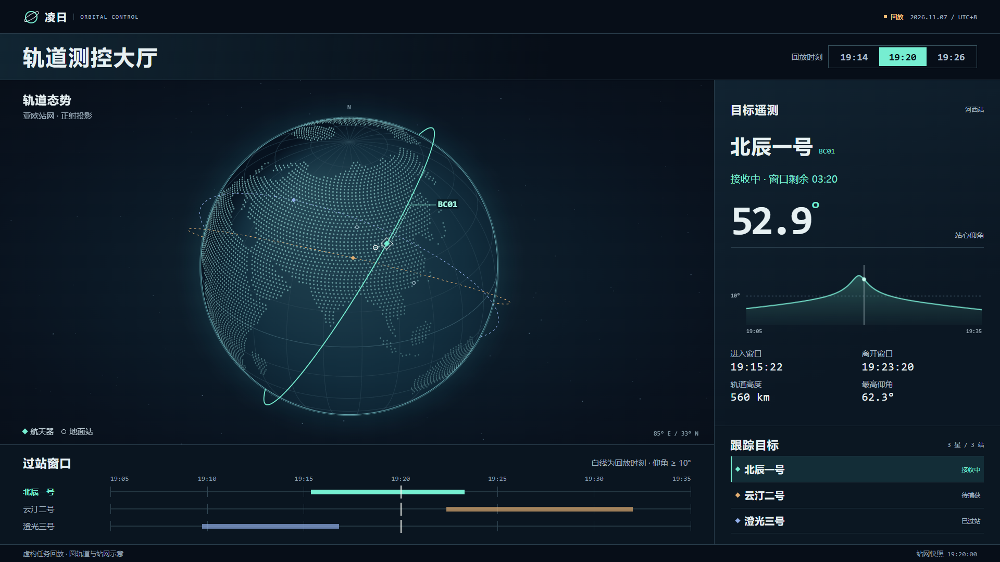
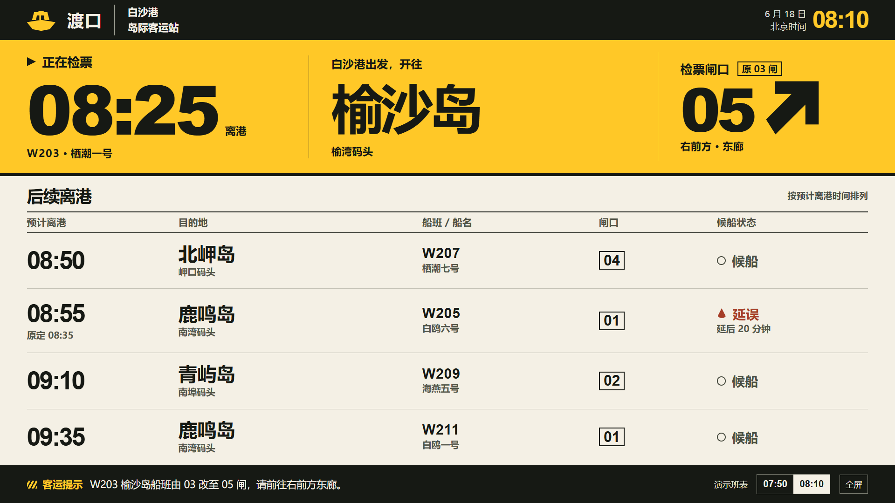

# FORMA UI/UX Design

为中文界面设计和实现前端的 Agent Skill。可用于轨道测控等指挥大屏、场馆公共信息屏、品牌官网、业务平台、App、微信小程序与 H5。提供按场景读取的设计指南，以及 24 个可以操作、切换视口和标注的独立 HTML 样页。

[GitHub Skills 正式版](https://github.com/fruge365/forma-frontend-design-studio/releases/tag/v11.0.0) · [skills.sh](https://www.skills.sh/fruge365/forma-frontend-design-studio/forma-ui-ux-design) · [Agent Skill Hub](https://agentskillhub.dev/u/fruge365/sk/forma-ui-ux-design) · [在线样页](https://fruge365.github.io/forma-frontend-design-studio/)



## 安装

在你的项目目录执行以下命令。使用 Codex 时可通过支持 `gh skill` 的 GitHub CLI 安装发布版本。

```sh
gh skill install fruge365/forma-frontend-design-studio forma-ui-ux-design@v11.0.0 --agent codex
```

使用 Vercel Skills CLI 时，可按技能名安装并选择目标 agent。Skills CLI 1.7.6 需要 Node.js 22.20 或更高版本。只运行下方的本地评审台时，Node.js 20 即可。

```sh
npx skills add fruge365/forma-frontend-design-studio --skill forma-ui-ux-design
```

也可手动将整个 [skills/forma-ui-ux-design](skills/forma-ui-ux-design/) 复制到项目的 `.agents/skills/`。入口、场景参考和样式资源要放在同一个技能目录里。[技能入口](skills/forma-ui-ux-design/SKILL.md)

## 用法

在项目中说明使用者、目标设备和一个关键任务，例如：

```text
使用 $forma-ui-ux-design 设计港口调度中心的 1920×1080 值守大屏。
值班员离屏约三米，需要一眼找到受影响的泊位和下一艘到港船。
实现正常、延误和改泊三种状态，并提供手机上的值班简报。
```

对现有界面也可以给出具体范围，例如“用 $forma-ui-ux-design 评审订单页，找出 390px 宽度下确认金额、错误恢复和按钮触达的问题，并修改对应组件。”

## 三种大屏，三种阅读方式

| 样页 | 首要任务 | 体验 |
| --- | --- | --- |
| 凌日 · 轨道测控大厅 | 在深色轨迹图上切换航天器和回放时间，核对目标与地面站窗口 | [在线打开](https://fruge365.github.io/forma-frontend-design-studio/orbital.html) · [HTML](html-review/orbital.html) |
| 渡口 · 岛际客运 | 从黄黑导视屏远读船次、时间与闸口，找到延误和改闸后的方向 | [在线打开](https://fruge365.github.io/forma-frontend-design-studio/departures.html) · [HTML](html-review/departures.html) |
| 江湾 · 能源运行中心 | 从供能态势追到趋势与站点，核对来源、单位和异常时间 | [在线打开](https://fruge365.github.io/forma-frontend-design-studio/bigscreen.html) · [HTML](html-review/bigscreen.html) |



## 更多场景

| 类型 | 可操作示例 |
| --- | --- |
| 品牌与文化 | [空间音箱官网](html-review/website.html)、[室内乐周](html-review/programme.html)、[河岸建筑导览](html-review/atlas.html)、[海报校样室](html-review/proofroom.html) |
| 业务系统 | [生产排程](html-review/scheduling.html)、[角色权限变更](html-review/policy-diff.html)、[库区作业板](html-review/depot.html)、[设备交班](html-review/handover.html) |
| 移动与内容 | [现场技师 App](html-review/field-app.html)、[访客报修小程序原型](html-review/repair-mini.html)、[阅读器](html-review/reader.html)、[手机选座](html-review/library.html) |
| 风格比较 | [财务、客户和仓储布局与配色](html-review/style-lab.html)、[材料样本馆](html-review/materials.html)、[版画装裱](html-review/editions.html) |

## 运行评审台

[打开在线评审台](https://fruge365.github.io/forma-frontend-design-studio/)，或克隆仓库后在根目录运行以下命令。需要 Node.js 20 或更高版本。

```sh
npm start
```

本机入口为 [127.0.0.1:4173](http://127.0.0.1:4173/)。选择样页后可独立打开，也可以在评审台内留意见、评分和导出 JSON。标注保存在当前浏览器。样页全部位于 [html-review/](html-review/)，可整体部署到静态主机；技能安装包仅包含技能本身。[评审操作手册](使用说明.md)

## 项目结构与检查

- [SKILL.md](skills/forma-ui-ux-design/SKILL.md) 声明技能适用条件、设计流程与交付方式。
- [references/](skills/forma-ui-ux-design/references/) 包含大屏、视觉构图、业务布局、移动交互和无障碍复核等按需读取的内容。
- [assets/](skills/forma-ui-ux-design/assets/) 提供可选的 CSS 语义变量。
- `npm test` 检查静态页面、服务器路径、文档链接及技能资源。浏览器回归可用 `npm install --no-save --package-lock=false playwright` 和 `npx playwright install chromium` 准备环境，再运行 `npm run test:spatial`、`npm run test:paper`、`npm run test:comparison`。

目录结构遵循 [Agent Skills 规范](https://agentskills.io/specification)。使用方式与文档组织参考了 [Anthropic Frontend Design](https://github.com/anthropics/skills/tree/main/skills/frontend-design) 和 [Vercel Web Design Guidelines](https://github.com/vercel-labs/agent-skills/tree/main/skills/web-design-guidelines)。产品视觉的观察来源与适用范围见[品牌案例](skills/forma-ui-ux-design/references/brand-research.md)。
